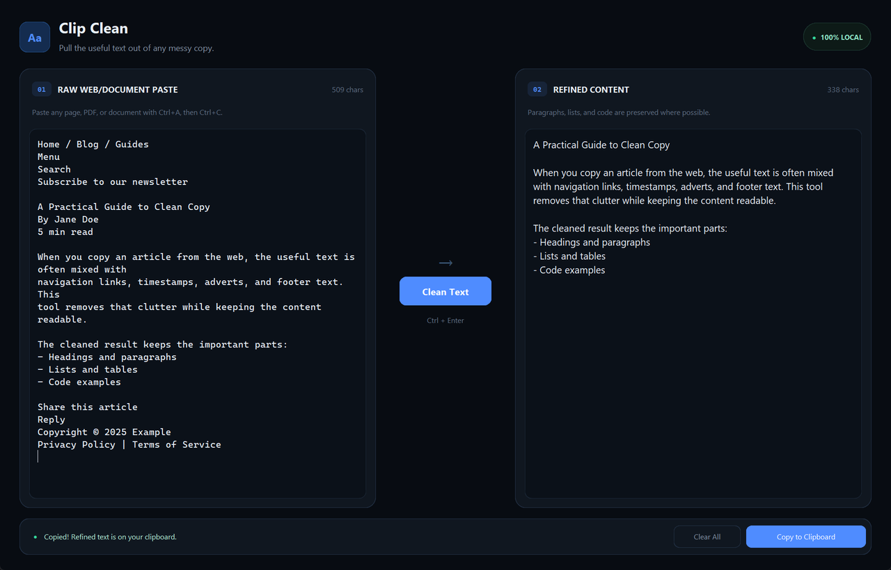
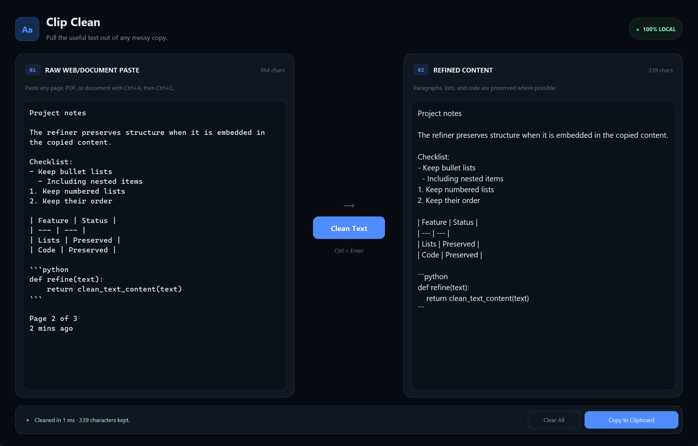
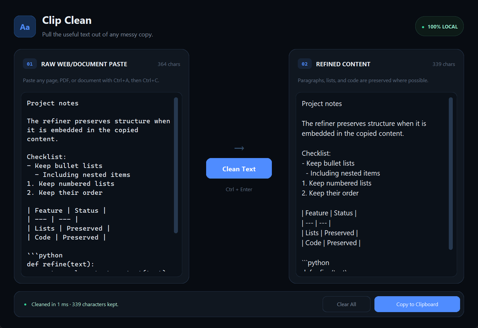

# Clip Clean

Copy text from any website, PDF, or document and paste it into Clip Clean. One click strips the clutter — nav links, cookie notices, timestamps, page numbers, newsletter prompts — and hands back only the content you actually wanted.

Everything runs on your machine. No internet connection, no account, no API key.


---

## What gets removed

- Navigation menus, breadcrumbs, and stray labels like "Home" or "Share"
- Cookie banners, newsletter sign-up prompts, and privacy-policy fragments
- Copyright lines, social-share buttons, and footer boilerplate
- Page numbers, counters, timestamps, and symbol-only lines
- Hard line-breaks introduced by PDF exporters and web scrapers

## What stays intact

- Paragraphs and their flow
- Bullet lists, numbered lists, and nested lists
- Markdown tables
- Fenced and indented code blocks
- Headings

---

## See it in action

### Web article — before and after

*Nav links, timestamps, and footer boilerplate gone. The article text remains.*

### Copy to clipboard with confirmation

*Hit Copy and the status bar confirms the refined text is on your clipboard.*

### Lists, tables, and code survive the pass

*Structured content is detected and left exactly as it was.*

### Responsive at any size

*The two-panel layout and scrollable editors hold up at the minimum 960 × 660 window.*

---

## How it works

Clip Clean runs a deterministic, regex-based pipeline — no AI, no model weights, no network:

1. **Normalize** — fix Unicode smart quotes, dashes, and stray control characters; collapse runs of spaces.
2. **Protect code** — fenced and indented code blocks are held aside before any cleaning begins.
3. **Strip boilerplate** — copyright lines, cookie notices, newsletter prompts, and social-share labels are removed by pattern matching.
4. **Drop navigation noise** — breadcrumbs, orphan labels, page numbers, timestamps, and symbol-only lines are discarded.
5. **Stitch paragraphs** — PDF- and scraper-inserted hard line breaks are rejoined into proper flowing paragraphs.
6. **Collapse whitespace** — runs of more than two blank lines are reduced to one.
7. **Restore code** — protected blocks are placed back exactly where they were.

---

## Download

Grab **clip_clean.exe** from the [Releases page](https://github.com/Icey067/Clipclean/releases/latest) and double-click it — no Python or installation needed.

## Run from source

Requires Python 3.10 or newer.

```powershell
py -m pip install -r requirements.txt
py clip_clean.py
```

## Build a standalone EXE

```powershell
py -m pip install pyinstaller
py -m PyInstaller --noconfirm --clean --noconsole --onefile --collect-all customtkinter clip_clean.py
```

Output: `dist/clip_clean.exe`

> The `--collect-all customtkinter` flag bundles CustomTkinter's theme and font assets into the binary. Without it the app will not start.

`dist/` and `build/` are listed in `.gitignore`. Attach the generated EXE to a GitHub Release rather than committing it.

---

## Project structure

```text
.
├── clip_clean.py          # Application source and all cleaning logic
├── requirements.txt       # Runtime dependencies (customtkinter, pyperclip)
├── .gitignore
├── README.md
└── docs/
    └── screenshots/
        ├── 01-cleaned-web-article.png
        ├── 02-copied-notification.png
        ├── 03-lists-tables-and-code.png
        └── 04-compact-window.png
```

---

## Keyboard shortcut

| Shortcut | Action |
|---|---|
| **Ctrl + Enter** | Clean the pasted text |

---

## Limitations

Clip Clean is a heuristic tool, not an AI. It is intentionally conservative — when in doubt it keeps a line rather than removes it. Unusual page layouts may still need a quick manual tidy. Code blocks are preserved reliably only when they are fenced (` ``` `) or clearly indented; heavily reformatted or image-based PDFs may not copy as plain text in the first place.

## Privacy

Clip Clean runs entirely offline. It never reads your clipboard automatically, never sends text anywhere, and contains no telemetry.
