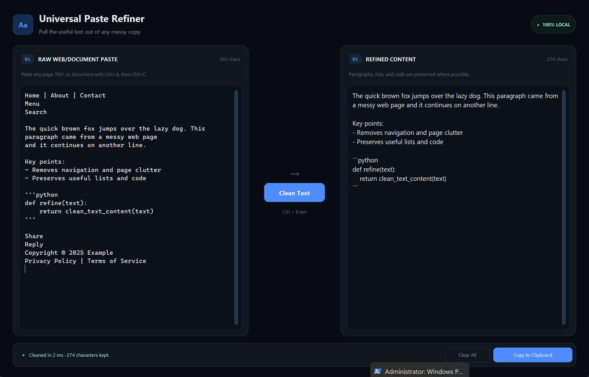

# Universal Paste Refiner

A clean, local-only Windows desktop app for turning messy copied text from websites, PDFs, and documents into readable content.



## What it does

Paste anything with **Ctrl+A → Ctrl+C**, click **Clean Text**, and the app removes common page clutter while preserving the useful parts.

It removes:

- Copyright, privacy-policy, cookie, and newsletter boilerplate
- Navigation menus, breadcrumbs, and orphan labels such as “Home” or “Share”
- Page numbers, counters, timestamps, and symbol-only lines
- Wrapped-line breaks from PDFs and web copies
- Excessive whitespace and blank lines

It preserves:

- Paragraphs
- Bullet and numbered lists
- Tables
- Markdown headings
- Fenced and indented code blocks

All processing happens locally. There are no API calls, keys, accounts, or telemetry.

## Download and run

The simplest option is to download the Windows executable from the repository’s **Releases** page, then double-click it.

The app does not require Python to be installed when using the executable.

## Run from source

### Option 1: Double-click the launcher

Double-click:

```text
run_local.bat
```

The launcher will:

1. Launch `dist/universal_text_refiner.exe` if a local build exists.
2. Otherwise, create a local virtual environment and install the required packages.
3. Start the Python app.

### Option 2: Run manually

```powershell
py -m pip install -r requirements.txt
py universal_text_refiner.py
```

Python 3.10 or newer is recommended.

## Build a standalone EXE

Double-click:

```text
build_exe.bat
```

Or run the equivalent command:

```powershell
py -m pip install pyinstaller
py -m PyInstaller --noconfirm --clean --noconsole --onefile --collect-all customtkinter universal_text_refiner.py
```

The executable will be created at:

```text
dist/universal_text_refiner.exe
```

The `--collect-all customtkinter` flag is important because it packages CustomTkinter’s theme and font assets.

## Project structure

```text
.
├── universal_text_refiner.py   # Application source and cleaning logic
├── requirements.txt            # Runtime dependencies
├── run_local.bat               # Easy Windows launcher
├── build_exe.bat               # Rebuilds the Windows executable
├── docs/
│   └── screenshot.png          # README preview
└── dist/
    └── universal_text_refiner.exe   # Local build, ignored by Git
```

`dist/` and `build/` are intentionally ignored by Git. Attach the generated EXE to a GitHub Release instead of committing it to the repository.

## Keyboard shortcut

- **Ctrl + Enter** — clean the pasted text

## Limitations

This is a heuristic cleaner, not an AI model. It is intentionally conservative, but unusual page layouts can still require a manual edit. Code is preserved reliably when it is fenced or clearly indented; heavily reformatted or image-based PDFs may not copy cleanly in the first place.

## Privacy

The application runs entirely on the local machine. It never uploads pasted text or uses an external service.
